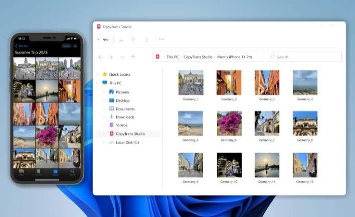
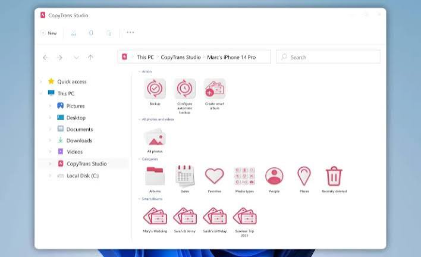

# CopyTrans Studio Gives iPhone Albums a Windows Home

CopyTrans Studio presents an iPhone or iPad photo library inside Windows Explorer.
An album you recognize on the phone can become a selected desktop collection, a photo-library backup, or a set of images prepared for sharing.
Choose the result you need before changing formats or organizing the exported files.

## Browse the Album You Already Recognize

Open CopyTrans Studio in Windows Explorer, select the connected device, and enter its photo library.
Browse the relevant album instead of reconstructing an event from unfamiliar camera-folder names.
The [official user guide](https://copytrans.studio/support/copytrans-studio-user-guide/) describes the Explorer integration and drag-and-drop workflow.

For a family event, select a small group containing a normal photo, a video, and a Live Photo if available.
Copy the selection to a clearly named destination on the computer.
Open those results before choosing the entire album.

Use a destination name that identifies the collection:

- Include the event or subject.
- Distinguish separate phones when combining family libraries.
- Keep originals apart from images converted for sharing.
- Give later exports a recognizable location.
- Retain the phone's source material until the desktop result is usable.

CopyTrans distinguishes [manual selection from photo-library backup](https://copytrans.studio/support/back-up-iphone-photo-library/).
Drag-and-drop suits a chosen collection.
The backup workflow provides additional organization choices for a broader library.

[](https://copytrans-studio.github.io/CopyTrans-Studio/)

## Preserve the Moving Part of a Live Photo

A Live Photo contains more than a still picture.
The CopyTrans Viewer guide describes an exported still image and MOV video with matching base names.
Keep those related files together when preserving the moving version.



The [Viewer instructions](https://copytrans.studio/support/how-to-use-copytrans-viewer/) explain how to open the pair and play its motion.
Test a representative Live Photo after copying it.
A folder containing a viewable JPEG alone does not establish that the motion component was retained.

| Media item | Files to retain | What to open | What the result represents |
| --- | --- | --- | --- |
| Ordinary HEIC photo | Original HEIC file | A HEIC-capable viewer | The original still-image file |
| Sharing copy | Converted JPG or PNG | The receiving application | A separate rendered still image |
| Live Photo export | Matching still image and MOV component | CopyTrans Viewer | A still image with its motion available |
| Standalone video | Exported MOV or MP4 file | A compatible video player | A video requiring its own playback check |

Avoid renaming only one member of a Live Photo pair.
When preparing a still image for a document, keep the original pair in the archive.
The document copy can serve a different purpose from the complete memory.

CopyTrans Viewer also opens supported ordinary images and videos.
Use it to check orientation, visible detail, and playback before relying on the export.

For image-format background, libheif's HEIF reader is declared in [decoder_heif.h](heifio/decoder_heif.h) and implemented in [decoder_heif.cc](heifio/decoder_heif.cc).
Its JPEG input path is represented by [decoder_jpeg.h](heifio/decoder_jpeg.h) and [decoder_jpeg.cc](heifio/decoder_jpeg.cc).
PNG input has a separate [decoder_png.h](heifio/decoder_png.h) and [decoder_png.cc](heifio/decoder_png.cc).
These readers illustrate how a format-specific input differs from the presentation of an album.

## Convert a Sharing Copy Without Replacing the Original

For a **copytrans studio heic** workflow, decide which application will receive the image.
JPG is useful for many ordinary sharing tasks, while PNG can suit workflows requiring that output format.
A PDF serves a document-oriented purpose rather than replacing the original photo collection.

CopyTrans Studio provides conversion from the Explorer context menu.
Select the intended HEIC files and use the available conversion action.
The [official HEIC conversion page](https://copytrans.studio/change-heic-to-jpg/) describes JPG, PNG, PDF, and batch conversion.

Review one converted image before processing a large selection.
Check dimensions, orientation, visible detail, and color in the destination application.
A successful file conversion does not automatically preserve every property of the source container.

### Decode a local HEIC image with libheif

With libheif's command-line tools installed and the required decoder available, this example requests a PNG output.
Use an existing local source and an unused output name.

```bash
heif-dec "garden-original.heic" "garden-sharing.png"
```

The [libheif usage documentation](https://github.com/strukturag/libheif#example-programs) describes decoding to common image formats.
A HEIF file may contain multiple images, so inspect the generated outputs.
This produces image files; it does not reproduce an iPhone album or a Live Photo's separate MOV component.

The JPEG output implementation is [encoder_jpeg.cc](heifio/encoder_jpeg.cc), with its interface in [encoder_jpeg.h](heifio/encoder_jpeg.h).
For PNG, see [encoder_png.cc](heifio/encoder_png.cc) and [encoder_png.h](heifio/encoder_png.h).
Other supplied output implementations include [encoder_tiff.cc](heifio/encoder_tiff.cc) with [encoder_tiff.h](heifio/encoder_tiff.h), and [encoder_webp.cc](heifio/encoder_webp.cc) with [encoder_webp.h](heifio/encoder_webp.h).

A codec implementation, a command-line conversion, and a Windows context-menu action are distinct integration layers.
Choose the layer that fits the task without assuming that their options are interchangeable.

## Make the Photo Backup Recognizable Months Later

Use CopyTrans Studio's photo-library backup when the goal is a repeatable library export.
The [backup instructions](https://copytrans.studio/support/how-back-up-iphone-photo-library/) describe a destination, album inclusion, optional HEIC conversion, date selection, and naming settings.
Review those choices together before starting a large backup.

For an archive, decide:

1. Which phone or tablet the backup represents.
2. Whether it includes the whole library or a selected period.
3. Whether album organization should be included.
4. Whether images remain in their original format.
5. Where another copy of the completed export will be kept.

A clear folder name helps distinguish two phones with overlapping photo dates.
If automatic JPG conversion is enabled, record that choice beside the export.
An original-format archive and a convenient sharing collection can coexist.



CopyTrans Studio also offers automatic photo-library backup.
Check that the expected device is connected and that the destination is available.
Verify the completed result instead of treating an enabled setting as evidence that a recent backup exists.

### Copy a finished export to another backup location

After CopyTrans Studio has finished exporting to a normal Windows folder, Robocopy can create another file copy.
Choose the completed export as the source and a distinct destination on a separate backup drive.

```powershell
$sourceExport = Read-Host 'Folder containing the completed photo export'
$secondCopy = Read-Host 'Destination folder on a separate backup drive'
robocopy $sourceExport $secondCopy /E /COPY:DAT /DCOPY:T /R:2 /W:2 /XJ
```

Microsoft documents the options in the [Robocopy reference](https://learn.microsoft.com/en-us/windows-server/administration/windows-commands/robocopy).
The command includes subdirectories, copies file data, attributes, and timestamps, and skips junctions.
It can update matching destination files, but does not delete destination-only files.

Read the final summary and investigate reported failures.
This second copy concerns exported files, not the connected phone or CopyTrans Studio's Explorer device view.
Keep the source and destination folders distinct.

## Resolve Missing Originals Before Repeating the Export

If a photo is visible on the iPhone but cannot be copied, check whether its original is local.
With optimized storage, the phone may keep a smaller representation while the full-resolution original remains in iCloud.
That is an availability question rather than proof that the photograph has been deleted.

CopyTrans explains that Studio [cannot retrieve iCloud-only originals directly](https://copytrans.studio/support/how-to-turn-off-icloud/).
It copies photo and video data made available by the iPhone.
Repeating the same export cannot supply an original that the device has not made available.

If using the phone to obtain originals, first check its free storage.
Allow the requested originals to finish arriving before assessing the desktop copy again.
Keep the phone on the connection and power conditions recommended in the official instructions.

### Keep wireless access and cloud access separate

CopyTrans Studio's Wi-Fi connection provides access to the phone on the local network.
It does not make Studio an iCloud photo-retrieval client.
The [wireless-transfer guide](https://copytrans.studio/support/transfer-photos-wirelessly/) describes an initial cable connection followed by enabling Wi-Fi access.

Use the same Wi-Fi network for the phone and computer.
Confirm that the intended device appears in Explorer before starting a large transfer.
If the connection changes, check a small copy before resuming the larger job.

For a **copytrans studio iphone** collection, record whether the export used USB or Wi-Fi.
This helps distinguish a connection interruption from missing local originals.
Check the completed desktop files in either case.

## Check Metadata in the Application That Will Use It

A photograph's visible pixels are only part of its usefulness.
Dates, orientation, and location may matter when organizing a family archive.
Check the fields you need after export and again after conversion.

Choose examples that exercise the collection:

- A portrait-oriented photo.
- A photo with a known capture date.
- An image with location information, if relevant.
- A Live Photo with motion.
- A video long enough to test more than its opening frame.

In libheif's supplied helpers, [exif.h](heifio/exif.h) declares orientation and image-size operations.
The related implementation is [exif.cc](heifio/exif.cc).
Shared output behavior is declared in [encoder.h](heifio/encoder.h) and implemented in [encoder.cc](heifio/encoder.cc).

Desktop thumbnail integration is another distinct concern.
[heif.thumbnailer](gnome/heif.thumbnailer) registers a GNOME thumbnail command, and [pixbufloader-heif.c](gdk-pixbuf/pixbufloader-heif.c) implements a gdk-pixbuf image loader.
Those Linux desktop references help distinguish image decoding from file-manager integration.

The supplied Go wrapper is [heif.go](go/heif/heif.go), accompanied by [heif_test.go](go/heif/heif_test.go).
The current libheif README marks this bundled wrapper as deprecated in favor of a separate Go project.
Use the current upstream guidance when studying its language interfaces.

## Match the Edition to the Collection You Need

Before relying on **copytrans studio premium** features, review the current plan's backup, conversion, and device allowances.
The [official product page](https://copytrans.studio/) and feature-specific guides describe the current offering.
Avoid choosing a plan solely from an old device-limit or conversion-limit summary.

Smart Albums can help group photos using supported criteria such as date, location, or people.
Check the actual selection before using a rule as the basis of an export.
A rule that finds a family event is useful only when it includes the material you intended to preserve.

For an incomplete result, record the device, connection type, selected album or period, original format, and destination.
State whether the problem concerns viewing, conversion, copying, or missing originals.
That description is more useful than treating every failure as a single transfer problem.

## Related Search Terms

CopyTrans Studio, CopyTrans Studio, copytrans studio premium, copytrans studio heic, copytrans studio iphone, ios, afc, libimobiledevice, usbmux, protocol, python, python3, fuse, fuse-filesystem, mount
